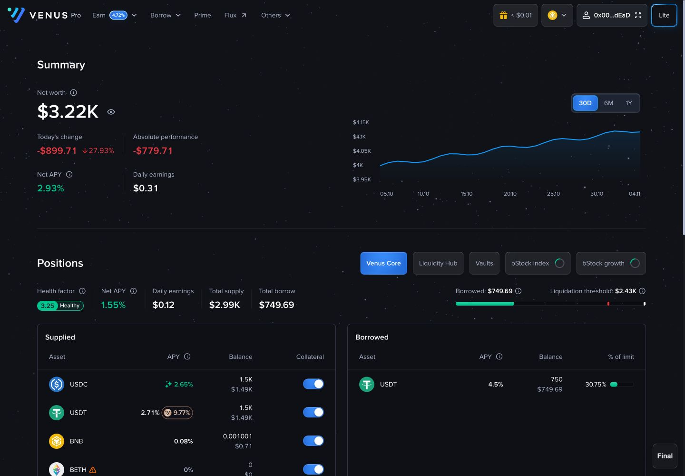
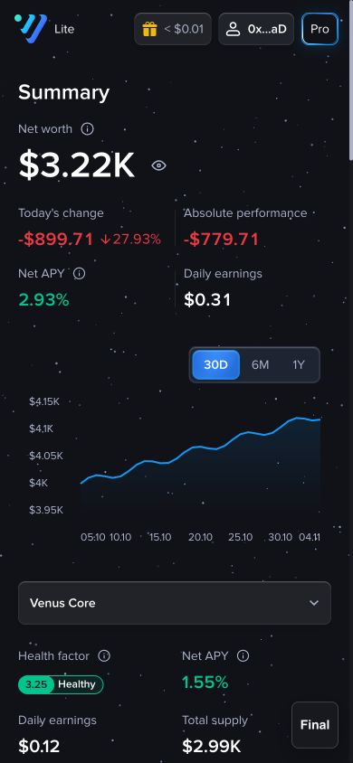
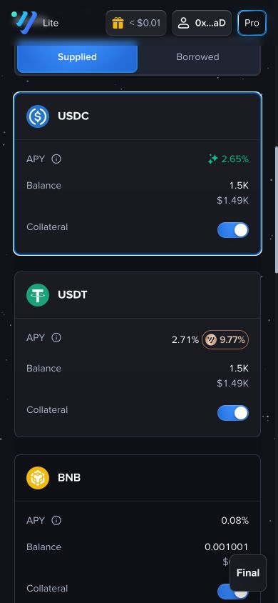
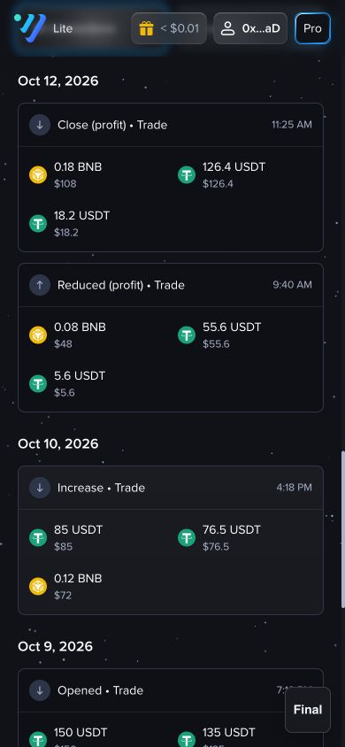
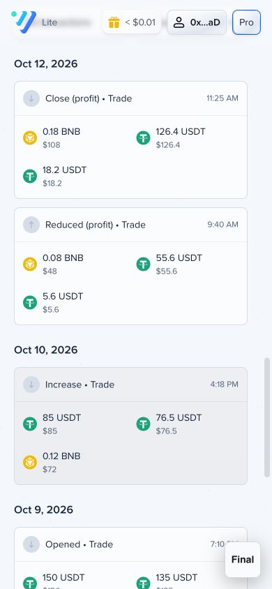
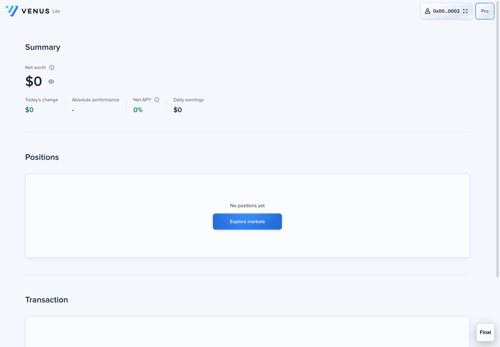

# Venus 共用 Dashboard — 設計與前端交接

**日期：2026-11-04 · 對象：Alvin／Fun N／前端團隊 · 狀態：最終網站版已部署**

> 最終決定：以目前 Lite Dashboard 作為唯一 Dashboard。Lite 與 Pro 使用同一套內容、元件、資料與響應式規則；介面模式只決定外層導覽及模式入口。以下以目前網站 Final 版本為準，取代今日較早的試驗值。

## 1. 交付與發布狀態

| 項目 | 狀態 |
|---|---|
| Lite／Pro Dashboard 合併 | 已完成，同一個 `/dashboard` 路由及頁面實作 |
| 網站 | 已上傳並完成線上抽查 |
| Lite 入口 | [開啟 Lite Dashboard](https://venus-ui-preview.vercel.app/#/dashboard?interface=lite&chainId=56) |
| Pro 入口 | [開啟 Pro Dashboard](https://venus-ui-preview.vercel.app/#/dashboard?interface=pro&chainId=56) |
| 發布專案 | Vercel `alvin-edec / venus-ui-preview`，屬此專案的分享預覽網站 |
| 本次部署 | `dpl_DvhRLbTdNbTSwiSLQvkmC6JGJDbG`，狀態 `READY`，正式 alias `venus-ui-preview.vercel.app` |
| 編譯核對 | 本機與線上入口均為 `assets/index-DrmT9mI2.js`；HTTP 200、HTML SHA256 一致 |
| Figma | 本輪沒有修改或發布 Figma |
| Git | 修改保留於目前 checkout；本輪未建立 commit／PR |
| Notion | [開啟獨立交接子頁](https://www.notion.so/40eb4e5771bb80688fabe8112b9e6009)，位於[指定的 Dashboard 頁面](https://app.notion.com/p/Dashboard-40eb4e5771bb80ec9a74da120497aab5)下；未變更分享權限 |

最新追加發布（2026-11-04）：包含目前 checkout 的 Dashboard 及 Lite 流程更新；沿用早前共用 Dashboard 規格，新增市場次序與持倉 modal 行為。下方較早部署及截圖保留為歷史紀錄，最新發布以本頁首表及本段為準。

本次驗證：線上 HTTP 200、HTML 與本機 build 完全一致；桌面 Lite 示範帳戶確認 Liquidity Hub 首位，USDT Supplied／Borrowed 行原頁開 modal，Borrow 預設 Loan。TypeScript、production build、git diff --check 通過。

本次自動檢查：Dashboard／AccountOverview／guest／Empty account／CSV／Lite mobile flow 共 **51 tests、7 files 通過**；已同步分類次序、Market 表頭、picker 欄位及預設 Loan 的舊測試預期。兩個新增 demo store 改用既有 curried create 寫法以配合測試 mock，Vault title 沿用 ModalProps 的型別，沒有更改產品布局。

另一位 AI 提供的手機檢查紀錄（本輪未重新逐頁執行）：375px Dark 主要流程、Dashboard 圖表及第一個市場 Liquidity Hub 未見問題；Light 只檢查 USDT。仍待驗收：手機 Dashboard 各行 modal、768px 新流程、未連 wallet 的 Prime 卡、其餘 Light 頁面、XVS Vault Total Supply USD（約 $6M 與預期約 $3.7M 差異）。Final 浮動 preview 掣遮擋不作產品修改。

Notion 已透過現有桌面 App 更新同一頁並重新載入確認保存。發布證據：`exports/lite-dashboard-latest-20261104/`。

### 預覽方法

1. 在網站按 **Connect wallet**，選 **Use Normal account**。
2. 從 Address 選單開啟 **View Dashboard**，或開啟以上 Dashboard 連結。
3. 選 Final 預覽，切換 Light／Dark；Lite／Pro 按鈕可在同一頁切換。
4. 空狀態請先 Disconnect，再選 **Use Empty account**。

帳戶及範例持倉是模擬資料；此流程不連接真實錢包、不發送交易。

## 2. 本次更新清單

1. **統一 Dashboard**：Pro 改用已確認的 Lite 排版，不再分開維護舊的 Markets／Vaults／Hubs／Transactions 主分頁。
2. **模式切換留在原頁**：Dashboard 上切換 Lite／Pro，保留 chain、交易篩選及 page URL 參數。
3. **上方 Summary**：Overview上方新增Summary標題；左側四項帳戶表現以2×2排列，右側無底色／外框的Chart；窄畫面上下排列。
4. **Chart**：直線連接數據點，保留藍色漸淡面積陰影；時間切換與圖表距離 12px。
5. **區塊分隔**：640px 起保留 Positions／Transaction 上方細線，線上下各 48px 總留白；小於640px隱藏這兩條橫線，區塊間隔24px。
6. **Positions**：標題24px／36px、600，1024px起標題左、分類按鈕右、同列垂直置中。較窄畫面上下排列，標題至分類16px；分類按鈕及手機Select最小高48px，與Transaction篩選器一致，四邊padding12px、按鈕間gap12px；長標籤可增高。
7. **市場分類**：Liquidity Hub → Venus Core → bStock index → bStock growth → Vaults；Desktop 按鈕及手機 Select 次序一致，無持倉的類別不顯示。
8. **持倉表一致**：Core／bStock 的 Supplied、Borrowed 共用欄寬、表頭高度、資料行高與字級。
9. **APY 靠右**：普通利率直接靠右；有獎勵時，利率與 badge 整組靠右，不保留空白 reward 槽。
10. **卡片實心**：持倉、手機資產卡、交易及持倉空狀態均不透出星星；Chart 最終版為透明無框。
11. **內外線分開**：內線與頁面分隔線較淡；卡片外框保留較實的原有 token。
12. **中性 hover**：沿用 Lite 市場中性灰色配方；資產名稱 hover 加粗，保留原本字色。
13. **Transaction**：加大篩選器、容許長文字換行；桌面整行 hover 到卡片內緣。
14. **手機交易**：Transaction 與 Download .CSV 同行、filters 下一行；日期在框外、每筆一張卡，移除外層框中框。
15. **分頁與 CSV**：每頁 20 筆；顯示筆數及目前頁碼；CSV 匯出目前篩選後的當頁資料。
16. **空帳戶**：有連接、無資產時顯示明確空狀態；不使用 Connect wallet 作為已登入用戶的提示。
17. **Footer 與清理**：Dashboard Footer 上方 padding 48px；社交 icon hover 品牌藍底白圖示；移除 totals 彩色圓點；返回頂部浮動箭頭暫時隱藏。
18. **手機最終版**：字級依Figma更新，兩條區塊橫線隱藏，資產卡及交易卡內線延伸到左右內緣、保留內容內距。
19. **空帳戶Summary**：640px起四項橫排、手機2×2；確認無歷史時整個Chart區不渲染。
20. **QC 修正**：共用 Modal 補上 Escape 關閉、Tab／Shift+Tab 焦點限制，以及關閉後返回觸發按鈕。

## 3. 頁面結構及共用方式

```text
Layout／NavBar（Lite 或 Pro 外殼）
└─ Dashboard（共用）
   ├─ Summary區塊（Dashboard頁面層）
   │  ├─ Summary標題
   │  └─ AccountOverview：Net worth、四項指標、PerformanceChart（30D／6M／1Y）
   ├─ 分隔線
   ├─ Positions
   │  ├─ 市場分類／手機 Select
   │  ├─ Health factor、收益及供借摘要
   │  └─ Core／Hub／Vaults／bStock 持倉
   ├─ 分隔線
   └─ Transaction（篩選、列表、CSV、分頁）
Footer
```

`LitePositions`、`.lite-dashboard` 等是沿用的內部名稱，現在同時供兩種模式使用。名稱不代表 Pro 仍有另一套 Dashboard。舊元件檔案保留，但 Dashboard 主流程不再使用舊 Pro 主分頁。

Final 版本直接由 Overview 進入 Positions，不顯示舊 Guide 三張卡。其他歷史 Test 預覽不是本次交付的驗收依據。

## 4. 字級、間距及幾何規格

### 4.1 全頁及 Overview

| 項目 | 最終規格 | 說明 |
|---|---|---|
| 基礎間距單位 | 現有 `--spacing`，4px | 沿用既有 token 倍數 |
| Overview 兩欄間距 | 24px | 1280px 起左右兩欄；較窄堆疊 |
| Summary／Positions／Transaction標題 | 24px／36px、600字重 | 共用`dashboard-section-title`；桌面標題列最少48px，手機Summary不保留48px最小高度 |
| 標題列→內容 | 桌面24px；手機Summary12px | Positions標題至分類在堆疊版為16px；手機Transaction標題列→filters為24px |
| Chart 容器 | 12px padding | 透明、無外框及卡片陰影；圖表本身保留漸淡面積 |
| Overview 四項指標 | 兩欄兩行、row gap24px | 手機column gap20px／row gap12px／值20px；640px起column gap40px／row gap24px／值20px；150%行高 |
| Today’s change 數值 | 金額＋百分比同一行 | 元素間手機4px，640px起8px；Hide balances遮蔽四項值 |
| 時間 switch → Chart | 12px gap | 不等同圖表軸內距 |
| Plot 高度 | 171px | 外框包含 switch、padding、軸標籤 |
| 1440px Chart 外寬 | 628px | 右邊與下方右側持倉卡對齊 |
| Positions／Transaction 分隔位置 | 640px起上下各48px總留白 | 小於640px兩條橫線隱藏、區塊gap24px；指標中間直線和卡片內線保留 |
| Footer 上方 | 48px padding | Lite／Pro Dashboard 一致 |

### 4.2 Positions 及持倉表

| 項目 | 最終規格 |
|---|---|
| Positions 標題 | 24px，600，150% 行高＝36px |
| 標題 → 分類按鈕 | 16px gap |
| 分類按鈕／手機Select | 最少48px高；四邊padding12px；文字14px／21px；長文字可增高 |
| 分類按鈕之間 | 12px gap |
| 分類區 → 摘要 | 24px gap |
| Supplied／Borrowed 標題 | 16px，600，24px 行高 |
| 交易日期 | 16px，600，24px 行高，與卡片標題同一文字規格 |
| Asset 表頭行 | 共用 Table 56px，取消曾試用的 40px 壓縮版 |
| 持倉資料行 | 60px 高；桌面 cell 左右 padding 24px |
| 資料文字 | 14px／21px；APY 600、Balance 400 |
| 欄寬 | Asset 24%／APY 32%／Balance 20%／最後一欄 24% |
| 最後一欄 | Supplied 為 Collateral；Borrowed 為 % of limit |
| APY 對齊 | 表頭及整個利率／獎勵組合靠右 |
| 借款佔比 | 完整百分比優先，進度條可收窄，不截掉文字 |

「Supplied」與交易日期使用相同字型規格，但仍是不同語意的元件。不要為了相同樣式將兩者的資料邏輯合併。

### 4.3 Transaction

| 項目 | 最終規格 |
|---|---|
| Transaction 標題 | 24px，600，150% 行高 |
| Desktop ≥1024px filters | 每個 280px；標題、filters、CSV 同行 |
| 640–1023px filters | 每個 240px，按可用寬度重排 |
| 手機 filters | 彈性等寬；放於標題／CSV 下一行 |
| Filter trigger | 最少 48px 高，文字可換行並增加高度 |
| Filter option | 最少 48px，高度可隨文字增加；padding 12px |
| Desktop 交易行 | 60px（18:25修訂）；hover延伸至左右卡片內緣，手機卡片仍依內容自動增高 |
| Desktop 內容內距 | 行內容及日期保留 16px 水平內距，列表外層不再截短 hover |
| 窄版交易 | 列表容器小於672px：日期在框外、每筆獨立實心卡片，移除列表外框／底色／陰影；卡內內容左右12px、內線延伸至左右內緣 |

### 4.4 手機最終字級與分隔線（Figma 1828:129419、417:50196）

| 項目 | 小於640px最終規格 |
|---|---|
| Summary標籤 | 14px／400／21px |
| Summary四項數值 | 20px／600／30px；百分比另計 |
| Today’s change百分比 | 16px／400／24px；金額仍20px／600 |
| Net worth | 40px／600／60px |
| Summary標題→內容 | 12px |
| 四項數據排版 | 2×2；row gap12px、column gap20px |
| 金額及百分比 | 375px以上實際示範值同一行；小於375px允許百分比整組換行，不縮小字級 |
| Health factor摘要 | 標籤14px、值20px；健康狀態pill12px／600 |
| 資產卡名稱 | 16px／600，hover700；APY與Balance14px／400 |
| 交易卡內容 | 14px／400；時間及法幣12px／400；日期16px／600 |
| 資產卡內線 | 延伸到卡片左右內緣，內容仍左右16px |
| 窄版交易卡內線 | 延伸到左右內緣，內容左右12px；這條規則跟隨列表容器小於672px，並非只限viewport小於640px |

內線「全寬」指外框內緣，量測與外框外緣相差1px。不是把文字padding移除，也不是把內線顏色改成外框色。

## 5. 顏色、背景與互動規則

使用現有 Design Token。以下合成色只供比對視覺；實作應綁定語意 token，不另建一批硬編碼顏色。

| 用途 | Light | Dark |
|---|---|---|
| 頁面底色 | `#F4F7FB` | `#101218` |
| Card | `#FBFCFE` 實心 | 黑色 10% 疊於頁面底色，約 `#0E1016`，實心 |
| Card 外框 | `#D4DDE8` | `#30354A` |
| 內線／區塊分隔線 | 黑色 6% | 白色 8% |
| 內線疊在 Card 的約值 | `#ECEDEF` | `#222329` |
| Light 內線疊在頁面上的約值 | `#E5E8EC` | 不適用 |
| Segmented control 底槽 | `#EDF2F8` 實心 | `#1E2431` 實心 |
| Selected control | 現有品牌藍色，白色文字 | 相同選中方案 |

主要語意 token：`surface/page/background`、`surface/card/fill`、`surface/line/stroke`、`border/card/default`；網站以現有 `--venus-*` 映射使用。

### Hover 與焦點

- 持倉及交易行：沿用外面 Lite 市場的中性灰色配方。Light 使用既有主要文字色 6%→7% 漸層，Dark 使用白色 5%→4% 漸層。
- 資產名稱：hover／focus-within 加粗至 700，保留 Light 深色／Dark 白色原字色。APY、金額不因整行 hover 全部加粗。
- APY 的綠色活動標記、Prime 色系屬各自語意，保留現有組件；不將中性 hover 改為藍字。
- Social icon：一般狀態中性，hover／鍵盤 focus 使用既有品牌藍底與白色 icon。
- 按住不代表長期 selected；原本選中狀態仍由 Tabs／ButtonGroup 的實際 state 決定。

### 背景與 Header

- Dark 保留原有星空。Dashboard 使用現有較低密度天空，Lite／Pro 相同。
- 持倉、Hub／Vaults、交易及空狀態都是實心卡，不讓星星透過卡片。Chart 最終版是透明無框，保留折線與漸淡面積。
- Lite Header：頁頂透明；捲動後使用已確認的 20% 半透明底與 4px blur，沒有突然出現的底線或強漸層。
- Pro 外層導覽保留原本導航行為，Dashboard 內容及線色、卡片、Footer 則與 Lite 共用。
- Total Supply 綠點與 Available Liquidity 黃點均已移除；返回頂部浮動按鈕暫時不 render，原元件保留。

## 6. 資料與可見性邏輯

### 6.1 市場分類

順序固定為：**Liquidity Hub → Venus Core → bStock index → bStock growth → Vaults**。

| 類別 | 顯示條件／內容 |
|---|---|
| Venus Core | 有正數 Supply 或 Borrow；單獨零餘額的 Collateral membership 不算持倉 |
| Liquidity Hub | 有正數 Hub 持倉 |
| Vaults | 有帳戶且現有 Vault 資料中 `userStakeBalanceMantissa > 0` |
| bStock index／growth | 保留現有 demo 規則及資料，不改為 Figma 的其他市場名稱 |

沒有該市場持倉就隱藏按鈕；這不是 KYC／白名單／使用權限檢查。Desktop 按鈕與 Mobile Select 共用同一組可用分類。選取類別消失時切到仍可用類別，資料回來不搶回用戶的選擇。

### 6.2 資產與操作

- Supplied／Borrowed 兩側使用一致表格，手機沿用資產卡及一個完整的 ButtonGroup 底槽。
- 重用原有 Market／Hub／Vault 組件與查詢，沒有另寫一套交易表單。
- Lite 持倉行直接在 Dashboard 開 modal：Supplied 開 Supply／Withdraw（標題「資產 / Venus Core」）；Borrowed 開 Borrow modal，預設 Loan tab。Pro 持倉行保留原本導航。
- Lite 表單：Core／Liquidity Hub／XVS Vault 的 Supply／Withdraw 使用 underline tabs；Borrow 的 Collateral 內層 Supply／Withdraw 保留 segmented。Hub Supply 保留 Wallet／Collateral 第二層。
- Collateral picker 只列 Max LTV、LT，兩者均有資訊 tooltip；不列 Penalty。Loan 表單內的 Liquidation penalty（例如 XVS 10%）仍保留，與 picker 欄位分開。
- Lite XVS Vault 標題為「XVS / XVS Vault」，沿用 Prime 排名卡；未連 wallet 文案為「#— / —」及「Connect wallet to see your rank.」。未連 wallet 的實際顯示仍待瀏覽器驗收。
- 外層 Borrow 搜尋保留 Search asset；進入特定借款資產的抵押品比較頁才使用 Search collateral。
- USDC 綠星 2.65%、USDT 基礎 2.71% + Prime 9.77% 是 demo 的版面展示。原生 reward 存在時優先，不新增真實收益或 Prime 資格。
- API／鏈上資料原有來源與資格邏輯保留。此輪不更改資產市場分類或利率計算。

### 6.3 Chart、交易及網址

- Chart 30D／6M／1Y 保留原有資料查詢；直線連接點，下方藍色陰影由約 20% 漸淡至 0；容器透明、沒有外框或卡片陰影。
- X 軸日期 `dd.MM`、7 個 tick；Y 軸金額 5 個 tick。兩軸留出分開的標籤區域，避免日期與金額撞在一起。
- Hide／Show balances 同步 Overview 與持倉數值；沒有重新定義歷史交易的隱私功能。
- Transaction 支援類型與來源多選、Reset、URL 篩選狀態。
- 每頁 20 **筆交易**，不是每頁 20 個日期；可輸入頁碼，無效或超出範圍會收斂至有效頁。
- 單頁有資料仍顯示筆數與第 1 頁；沒有資料則不顯示空分頁。
- Normal demo 現有 6 筆，所以顯示 `Items 1 - 6 out of 6`；不代表系統最多 6 筆。
- Download .CSV 匯出 **目前篩選後、目前頁** 的資料。交易含多個資產時 CSV 可有多行，行數不等於交易筆數。
- 在 Dashboard 切換 Lite／Pro，保留 path、chainId、page、txType 等 query；不再切回首頁。

## 7. 未登入與空帳戶

| 狀態 | 行為／文案 |
|---|---|
| 未登入直接開 Dashboard | 不 render Dashboard；replace 導向首頁入口，保留 interface／chainId，移除交易篩選與分頁。Pro 隨現有首頁導航可再到 Liquidity Hub |
| Dashboard 登出 | 同上，不留在個人 Dashboard |
| 已登入、確認無 performance history | 不渲染圖表、時間switch、空圖表提示或預留右欄；Summary滿寬。640px起四項數據橫排，手機2×2；Loading／Error不當作空歷史 |
| 已登入、無持倉 | **No positions yet** + **Explore markets**；不顯示空市場按鈕 |
| 已登入、無交易且無篩選 | **No transactions yet**；收起 filters、CSV、分頁 |
| 有篩選但無結果 | 保留 filters／Reset，方便用戶解除條件 |
| 已隱藏餘額 | 數值遮蔽，Chart 顯示 **Balances hidden** |

Empty account 使用獨立模擬地址 `0x0000000000000000000000000000000000000002`。Wallet、Supply、Borrow、Collateral、Vault stake、Performance 與 Transactions 為空；不注入範例 Hub／bStock 持倉。Session 刷新可保留，Normal／Prime 原有範例仍保留。

## 8. 響應式規則

這次以 **1440／1280／1024／768／640／390px 實際 DOM viewport** 檢查，不以螢幕截圖比例猜測尺寸。

| 寬度 | 表格及區塊行為 |
|---|---|
| 1440px | Overview 左右兩欄；Core 兩張持倉表並排，各 628px |
| 1280px | Overview 左右兩欄；持倉表依實際可用容器寬度堆疊 |
| 1024px | Overview 堆疊；持倉表堆疊；Transaction title／filters／CSV 同行 |
| 768px | 持倉表堆疊；交易保留桌面列表外框 |
| 640px | 持倉仍是表格；交易容器不足 672px 時改每筆卡片、日期框外 |
| 390px | Positions 使用 Select；Supplied／Borrowed 使用資產卡與共用底槽；Transaction／CSV 同行、filters 下一行 |

持倉表使用 container 可用寬度判斷：每張最低約 600px 才並排，不單靠 viewport 斷點。Transaction 在列表容器小於 672px 時移除列表外框。這兩個條件不要合併成一個全域手機 breakpoint。

## 9. QC 結果與修正

### 9.1 本機 layout matrix

較早全頁檢查為 **2 modes × 2 themes × 6 widths＝24 個狀態**。其後新增手機字級、空Summary、交易容器邊界及分隔線專項。以下分開標示本機矩陣與最新線上抽查，沒有把較早截圖當成最新發布證據。全頁矩陣核對：

- 頁面及內容容器無橫向溢出。
- 共用 Dashboard 存在，舊 Dashboard 主分頁數量為 0。
- Positions／Transaction 存在，無重複 Positions 標題。
- Transaction 與 CSV 保持同一行，中心差小於 2px。
- Dashboard 圖片沒有破圖。
- Dark／Light 的內線符合各自核准配方。
- Lite／Pro 使用相同持倉表幾何；1440px 兩表各 628px。

原始證據：`responsive-matrix.json`。這是 DOM 量測加代表性視覺截圖，不等於 24 張畫面都完成真人視覺驗收。

### 9.2 互動實測

| 項目 | 結果 |
|---|---|
| Lite ↔ Pro | 留在同一 Dashboard；保留篩選與頁碼參數 |
| Repay 篩選 | 6 筆變 1 筆；刷新仍保留；Reset 回 6 筆 |
| 手機 Positions | Core／Hub／Vaults 可切換，還原 Core |
| Chart period | 6M／1Y 選取狀態正確，再還原 30D |
| CSV | 實際瀏覽器下載；8 欄一致，Normal demo 為 17 行含 header |
| 空帳戶 | 三個空狀態、分類／filters 收起、刷新保留 |
| 未登入／登出 | 離開 Dashboard，未顯示個人頁內容 |
| Modal Escape | 修正前未關閉；已補上並實測可關閉，返回 trigger |
| Modal Tab | 補上 Tab／Shift+Tab 循環，單元測試通過 |
| 線上餘額顯示 | Hide／Show 可切換，持倉與 Overview 同步遮蔽／還原 |

Modal 修正沿用既有元件，未新增另一套彈窗。Focusable controls 按 DOM 次序整理，避免順序不一致造成 Tab 無法正確循環。

### 9.3 最新自動檢查

| 檢查 | 最新結果／範圍 |
|---|---|
| AccountOverview、Dashboard、LitePositions、guest、Empty account、CSV | **42 tests／6 files 通過**；包括空歷史、Loading、Error 分開處理 |
| TypeScript | `tsc --noEmit` 通過 |
| Dashboard CSS | Stylelint 通過 |
| Production build | Vite build 通過，21.91秒；依賴 pure-annotation／plugin timing 警告仍存在，無build error |

以上是本次發布前重跑的相關檢查，並非全repo測試全綠。較早的Modal／NavBar／分頁檢查留於QC紀錄，不累加為本輪42項。

### 9.4 最新線上確認

- 發布 `dpl_B4D36nuXub6VFAZGHNqAyhvPy6Uu`：Vercel `READY`，Production alias `venus-ui-preview.vercel.app`。
- HTTP 200；線上與本機入口一致 `assets/index-6tyKnsi7.js`，HTML SHA256一致。
- 1440px Pro Dark：Chart透明、border 0、外寬628px；百分比16px／400／24px；6筆交易每行60px，無橫向溢出。
- 線上從Pro切Lite仍在Dashboard；390px Lite Dark：兩條區塊橫線display none，百分比16px。
- 390px資產卡與交易卡：內線兩端距外框均1px，正好在外框內緣；資產內容padding16px、交易內容12px。內線Dark白8%，Light黑6%。
- 390px交易卡已保存Dark／Light線上截圖。
- Empty account：390／640／1440px無圖表、無溢出；640px起四項橫排、390px兩欄；Positions／Transaction空卡保留。
- 未連接直接開Pro Dashboard會離開Dashboard，循現有Pro首頁導航到Liquidity Hub。
- 本機最新卡片分隔線亦核對375／390／640／768／1440px；768／1440px的交易卡內線隱藏，使用桌面列表。

### 9.5 本機專項證據

- `exports/mobile-dashboard-typography-20261104/geometry.json`：320／375／390／576／639／640／768／1440px，Lite Dark及Pro Light，共16狀態；均無橫向溢出。
- `exports/transaction-frame-fix-20261104/`：兩種mode/theme組合、各8種寬度，包含列表容器671／672px邊界。
- `exports/empty-summary-20261104/`：Empty account六種寬度、Pro Dark及Lite Light。
- `exports/dashboard-final-release-20261104/`：最新發布之HTTP、線上DOM量測、分隔線量測及截圖。

## 10. 最新發布截圖

下列均為正式預覽網址的最新部署，使用模擬帳戶；不是Figma export或真實錢包資產證明。













## 11. 前端修改位置

以下路徑均相對 `apps/evm/src/`：

| 檔案／位置 | 責任 |
|---|---|
| `pages/Dashboard/index.tsx` | 唯一 Dashboard、guest redirect、共同 Overview／Positions／Transaction |
| `pages/Dashboard/figma-dashboard.css` | 最終布局、字級、間距、實心卡片、hover、響應式 |
| `pages/Dashboard/LitePositions.tsx` | 市場可見性、分類、Vaults、手機資產切換 |
| `pages/Dashboard/positionTableLayout.ts` | 兩張持倉表共同欄寬 |
| `pages/Dashboard/Transactions/index.tsx` | filter／CSV／空狀態／交易版面 |
| `pages/Dashboard/Transactions/createTransactionsCsv.ts` | 當頁交易 CSV |
| `containers/AccountOverview/PerformanceChart/` | line chart、軸標籤、期間 |
| `containers/Layout/index.tsx` | Lite／Pro Dashboard 天空與 Layout；暫時隱藏返回頂部箭頭 |
| `containers/Layout/NavBar/index.tsx` | Dashboard 內模式切換保留 route／query |
| `containers/Layout/Footer/index.tsx` | 共用 Dashboard Footer 間距 |
| `assets/styles/lite-dividers.css` | 核准內線規則涵蓋 Pro Dashboard |
| `components/Modal/index.tsx` | Escape、焦點限制與還原 |
| `components/Modal/glass.css` | Final 共用中性 popup 材質 |
| `demo/state.ts`、`demo/DemoLogin/` | Normal／Prime／Empty 模擬帳戶 |

測試檔位於上述元件／頁面的 `__tests__` 及現有 `*.spec.tsx`。本輪移除過時的舊 Dashboard snapshot，改用兩模式共用行為測試；沒有刪除現有產品元件。

## 12. 驗收範圍與待辦

已完成網站布局、模式共用、代表性互動、本機全頁與專項DOM QC、最新42項相關測試及正式預覽發布。線上另作代表性抽查，並非重跑完整真機矩陣。

仍需分開驗收：

- **Notion 位置**：本文件同步到既有私人Dashboard交接子頁，未變更分享權限或向團隊發送訊息。
- **真實帳戶與資料**：本輪使用 demo；尚未驗收真實資產、收益、Prime 資格及所有鏈。
- **真機瀏覽器**：390／640／768 等為瀏覽器 viewport，未完成實機 iOS／Android／Safari 的完整矩陣。
- **交易**：沒有送出任何真實 Supply／Withdraw／Borrow／Repay；僅核對已有表單與切換。
- **可用性完整稽核**：此次修正 Modal 鍵盤操作，不宣稱所有現有小尺寸 icon／觸控目標已完成全面 WCAG 稽核。
- **Figma**：本輪只修改網站及文件；要在 Figma 對應回寫／發布需另行處理。

### 交接時請保留的五條規則

1. 一個 Dashboard，Lite／Pro 不再另起一套。
2. 內線淡、外框實；Dark 白 8%、Light 黑 6%。
3. Card 實心，Dark 星空只在卡片外。
4. APY 及 reward **整組靠右**，不要恢復空白 reward 預留槽。
5. 市場按鈕根據持倉顯示；手機與桌面共用同一條件。
